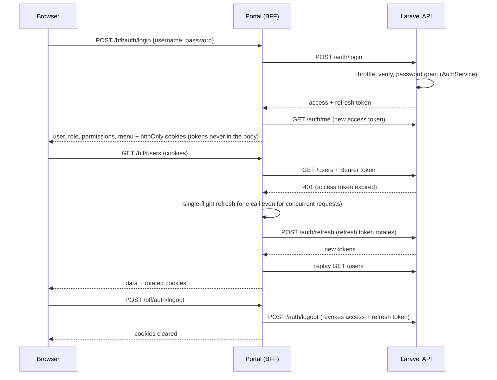

# Store Management System

Foundation for a single-store management system: Docker infrastructure, authentication, users,
roles/permissions/menus and a themed portal shell. Business modules (products, purchasing, stock,
POS, …) plug into it later.

## Application summary

**What it is.** A web application for running one retail store. Staff sign in to a browser portal;
what each person sees and can do depends on their role. This first phase delivers the secure base
every later feature builds on, so new modules only need to add their own screens, routes and
permissions.

**Who uses it.**

| Role       | Typical person        | Default access                                                                 |
| ---------- | --------------------- | ------------------------------------------------------------------------------ |
| `owner`    | Store owner           | Everything. Always holds every permission; cannot be locked out or demoted.    |
| `manager`  | Shift or store manager | Dashboard, all business modules and reports, plus view/create/edit users (Employees only). |
| `employee` | Cashier, shop floor   | Dashboard, point-of-sale selling and holding, view products, view/add customers, view stock. |

The Owner can edit what Manager and Employee may do, and can create extra roles (for example
`stock-keeper`). Each user has exactly one role.

**What works today.**

- **Sign-in and sessions:** username and password, forced password change on first sign-in and after
  an administrator reset, automatic session renewal, sign-out everywhere on deactivation or reset,
  login throttling.
- **Users:** search, filter by role and status, sort, paginate; create, edit, activate/deactivate,
  soft-delete, reset password; profile photos (JPEG/PNG/WebP, resized to 512×512 WebP); every change
  written to an activity log. The Owner manages everyone, a Manager manages only Employees, nobody can
  delete or deactivate themselves, and the last active Owner is protected.
- **Roles and permissions:** a grouped permission matrix per role, a read-only permission catalogue,
  and changes that apply on the next request. The catalogue already lists the planned business
  modules (catalog, suppliers, purchasing, inventory, point of sale, customers, expenses, reports).
- **Menus:** the sidebar is data-driven; each item is linked to a permission, so people only see what
  they may use. Owners can add, reorder, hide and edit items without a deployment.
- **Portal shell:** light and dark themes (remembered without flicker), collapsible sidebar and
  mobile drawer, breadcrumbs, 403 and 404 pages, toasts, confirmation dialogs, loading, empty and
  error states.
- **Settings:** store name, currency (BDT), timezone (Asia/Dhaka) and date format are stored and
  served publicly; an editing screen is planned.

**Planned next** (permissions and menu slots are already reserved): product catalogue and pricing,
suppliers and purchasing, stock control (adjustments, write-offs, stocktakes), point of sale (sales,
holds, discounts, returns, cashier sessions), customers and credit, expenses, and reports.

**Scope.** One store, one database, English only, online only. TLS termination, Redis, CI/CD and
Bangla localisation are intentionally out of scope for this phase.

| Part       | Stack                                                                                  |
| ---------- | -------------------------------------------------------------------------------------- |
| API        | Laravel 13 (PHP 8.4), Passport 13, spatie/laravel-permission, activitylog, query-builder |
| Portal     | Next.js 16 (App Router, strict TypeScript), TanStack Query, Redux Toolkit, Tailwind 4, shadcn/ui |
| Database   | PostgreSQL 18                                                                          |
| Gateway    | nginx 1.30 (unprivileged)                                                              |

## Quick start (development)

```bash
cp .env.example .env
docker compose up -d --build        # first start installs dependencies; allow a few minutes
docker compose ps                   # everything should become "healthy"
```

| URL                          | What                                                        |
| ---------------------------- | ----------------------------------------------------------- |
| http://localhost:3000        | Portal                                                      |
| http://localhost:8080        | Gateway (`/api/v1/...`, `/storage/...`, and the portal)     |
| http://localhost:8081        | Adminer (only with `docker compose --profile tools up -d`)  |

On first start the API container generates the app key, Passport keys and the portal's Passport client
into `api/.env` / `api/storage` (git-ignored), runs migrations, and **you seed once**:

```bash
docker compose exec store-api php artisan db:seed
```

Sign in with `SEED_ADMIN_USERNAME` / `SEED_ADMIN_PASSWORD` from `.env` (the example values are
placeholders). You are forced to choose a new password immediately. In the `local` environment the
seeder also creates a `manager` and an `employee` user with `SEED_DEMO_PASSWORD`.

### Containers

| Container         | Role                                                                          |
| ----------------- | ----------------------------------------------------------------------------- |
| `store-nginx`     | Gateway: PHP (FastCGI) for `/api/`, uploads at `/storage/`, everything else proxied to the portal. Port 8080 |
| `store-api`       | PHP-FPM running Laravel. **The only container that runs migrations** (`RUN_MIGRATIONS`) |
| `store-worker`    | `queue:work` (same image as the API)                                          |
| `store-scheduler` | `schedule:work` (same image as the API)                                       |
| `store-portal`    | Next.js, port 3000                                                            |
| `store-postgres`  | PostgreSQL, named volume `store-pgdata`, bound to `127.0.0.1` in development  |
| `store-adminer`   | Optional (`tools` profile), development only                                  |

Volumes: `store-pgdata` (database) and `store-uploads` (files, mounted read-write into api/worker/
scheduler and read-only into nginx). Both survive `docker compose down`; only `down -v` removes them.
One bridge network, `store-network`; only nginx, the portal and (dev) Postgres publish ports.

> **Windows/macOS note.** Docker Desktop mounts `./api` and `./portal` as `root`, so development
> containers run as root there (`DEV_USER=0:0`). On Linux set `DEV_USER` to your uid:gid. Production
> images always run as non-root users (`app`, `node`, `nginx`).

## Everyday commands

```bash
# API
docker compose exec store-api php artisan migrate:fresh --seed     # reset the database
docker compose exec store-api php artisan db:seed                  # idempotent, safe to repeat
docker compose exec store-api composer test                        # Pest (uses the store_testing database)
docker compose exec store-api composer lint                        # Pint (check only)
docker compose exec store-api vendor/bin/pint                      # Pint (fix)
docker compose exec store-api composer analyse                     # Larastan
docker compose exec store-api php artisan store:passport-client    # create/verify the portal's OAuth client

# Portal
docker compose exec store-portal npm run lint
docker compose exec store-portal npm run typecheck   # generates route types, then tsc
docker compose exec store-portal npm test
docker compose exec store-portal npm run build                     # production build check
docker compose exec store-portal npm run format

# Logs / reset
docker compose logs -f store-api
docker compose down            # keep data
docker compose down -v         # also delete the database and uploads
```

The test suite refuses to run against any database other than `store_testing` (see
`api/tests/bootstrap.php`), so it can never touch development data.

## Environment variables

Everything is configured through environment variables; the root `.env.example` documents each.

| Variable | Default | Purpose |
| --- | --- | --- |
| `APP_ENV`, `APP_DEBUG`, `APP_URL`, `LOG_LEVEL` | `local`, `true`, … | Laravel environment. Production forces `APP_DEBUG=false`. |
| `DB_DATABASE`, `DB_USERNAME`, `DB_PASSWORD` | `store`, `store`, `change-me` | PostgreSQL. Production refuses `change-me`. |
| `RUN_MIGRATIONS` | `true` (dev), `false` (prod) | Run migrations on `store-api` start. |
| `UPLOAD_MAX_SIZE` | `5M` | One variable: PHP `upload_max_filesize`/`post_max_size` **and** nginx `client_max_body_size`. |
| `ACCESS_TOKEN_TTL_MINUTES` / `REFRESH_TOKEN_TTL_DAYS` | `15` / `14` | Token lifetimes (the portal reads the latter to size its refresh cookie). |
| `LOGIN_MAX_ATTEMPTS` / `LOGIN_DECAY_SECONDS` | `5` / `60` | Login throttle per username + IP. |
| `COOKIE_SECURE` | `true` in production | `Secure` flag on portal cookies. |
| `SEED_ADMIN_NAME`, `SEED_ADMIN_USERNAME`, `SEED_ADMIN_EMAIL`, `SEED_ADMIN_PASSWORD` | see file | The primary (Owner) user. Production refuses a missing or example password. |
| `SEED_DEMO_PASSWORD` | see file | Demo manager/employee, `local` environment only. |
| `DEV_USER`, `APP_UID`, `APP_GID` | `0:0`, `1000` | Container users (see the note above). |
| `APP_KEY`, `PASSPORT_PRIVATE_KEY`, `PASSPORT_PUBLIC_KEY`, `PASSPORT_PORTAL_CLIENT_ID`, `PASSPORT_PORTAL_CLIENT_SECRET` | generated in dev | **Required in production**; never baked into images or committed. |

## Architecture

```
Browser ──► Portal (Next.js, :3000)  ──► /bff/* route handlers ──► Gateway (nginx) ──► Laravel (PHP-FPM) ──► PostgreSQL
                │                                   (tokens in httpOnly cookies)
                └─ /storage/* rewritten to the gateway so images load from the portal's origin
```

* The **browser only talks to the Next.js server** (backend-for-frontend). There is no CORS in the
  browser flow and tokens never reach JavaScript or Redux.
* The portal keeps UI state in Redux (`auth` mirror, `ui` preferences) and **all server data in
  TanStack Query**.
* Uploads: the `public` disk (images) is served by nginx straight from the volume at `/storage/`
  (aliased, no symlink, PHP execution forbidden, `nosniff`). The `private` disk (documents) is never
  web-served; expose it through an authenticated, permission-checked endpoint per module using
  `FileStorageService::downloadPrivate()`.

### Authentication flow



* Cookies: `httpOnly`, `SameSite=Lax`, `Secure` in production. The access cookie expires shortly
  before the token; the refresh cookie lasts `REFRESH_TOKEN_TTL_DAYS`.
* `proxy.ts` (Next.js 16's renamed middleware) redirects signed-out users to `/login`, signed-in users
  away from it, and users flagged `must_change_password` to `/change-password`. It is a routing aid;
  the API validates every token and permission itself.
* Refresh tokens rotate and are single-use; after logout they cannot be reused.
* The refresh lock lives in process memory, which is correct for the single portal instance. Behind
  several instances, back it with a shared store.

### Why the password grant, and how to replace it

Passport's documentation advises against the OAuth password grant (it is removed in OAuth 2.1) because
the client handles raw credentials. It is used here because the portal is first-party and is the only
thing that ever sees the password, and tokens are kept out of the browser. The risk is contained by
isolating it:

* All token issuance, refresh and revocation lives in **`App\Services\AuthService`** (one
  `issueToken()` method calls Passport's authorization server in process; `/oauth/*` routes are not
  exposed by the gateway).
* To move to authorization code + PKCE (or another grant), replace `issueToken()`, `login()` and
  `refresh()` there and the three BFF handlers; controllers, policies, the portal and the cookie
  contract stay unchanged.

## Roles, permissions and menus

* **Permissions** are named `module.action` (`users.view`) and defined only in code:
  `App\Support\PermissionCatalog`. `PermissionSeeder` creates them; nothing creates permissions at
  runtime. The catalogue already includes the planned business modules.
* **Roles**: `owner`, `manager`, `employee` are built-in (cannot be renamed or deleted). Owner is
  re-synced with every permission on every seed and its permissions cannot be reduced. Manager and
  Employee receive defaults only when first created, so the Owner's customisation survives re-seeding.
  Extra custom roles can be created. Each user has exactly one role.
* **Hierarchy rules** (`UserPolicy`): the Owner manages everyone; a Manager manages only Employees and
  can assign only the Employee role; nobody deletes, deactivates or re-roles themselves; the last
  active Owner is protected; nobody can grant permissions they do not hold.
* **Menus** are a custom table (Spatie has no menu feature), each linked to a permission. An item is
  visible if the user has its permission; a group is visible if it has a visible child. Edit them in the
  portal under Administration → Menus. Icons come from a whitelist (`App\Support\MenuIcons` ↔
  `portal/lib/icons.ts`).
* Every role, permission or menu change resets Spatie's permission cache, so it applies on the next
  request.

## Adding a new module (example: `suppliers`)

1. **Permission**: it is already in `PermissionCatalog`; for something new add it there and run
   `php artisan db:seed` (Owner picks it up automatically; grant it to other roles on the Roles page).
2. **API route**: in `api/routes/api.php`, inside the authenticated group:
   `Route::get('suppliers', [SupplierController::class, 'index'])->middleware('permission:suppliers.view');`
   Use a Form Request, an API Resource and a service class; log changes with `activity('suppliers')`.
   Add a Policy only for self-protection or hierarchy rules.
3. **Menu**: add an entry to `MenuSeeder::definitions()` (key, title, icon, path, permission) and seed,
   or create it in the Menus screen.
4. **Page**: add `portal/app/(app)/suppliers/page.tsx` rendering a component from
   `portal/features/suppliers/`, with TanStack Query hooks in `api.ts` and keys in
   `portal/lib/query/keys.ts`.
5. **Route guard**: add the path to `portal/lib/routes.ts` so the shell shows the 403 page without the
   permission. Use `<Can permission="suppliers.create">` to hide buttons (presentation only).
6. **Tests**: a Pest feature test for the route's permission and rules; extend the dataset in
   `PermissionMiddlewareTest` so the route is proven protected.

## Production

```bash
cp .env.example .env     # set APP_ENV=production, real secrets, APP_KEY, Passport keys and client
docker compose -f docker-compose.yml -f docker-compose.prod.yml up -d --build
docker compose -f docker-compose.yml -f docker-compose.prod.yml exec store-api php artisan db:seed --force
```

* Production images are built from the `*-prod` targets, run as non-root, ship `vendor/` and the
  standalone Next.js server, cache config/routes/views on start and **refuse to start** without
  `APP_KEY`, Passport keys, a real `DB_PASSWORD`, and (when seeding) a real admin password.
* Generate secrets: `php artisan key:generate --show`; `openssl genrsa -out private.pem 4096` and
  `openssl rsa -in private.pem -pubout -out public.pem`, then put the PEM contents in `.env` with
  newlines written as `\n`; run `php artisan store:passport-client` once and copy the printed values.
* Postgres is not published to the host in production; Adminer is disabled.
* **TLS** is out of scope for the stack. Put a TLS-terminating reverse proxy (Caddy, Traefik, nginx,
  a cloud load balancer) in front of the gateway on port 8080 and forward `X-Forwarded-For` and
  `X-Forwarded-Proto`. Keep `COOKIE_SECURE=true`; cookies will not be sent over plain HTTP.

## Security notes

* No secrets in images or the repository; `.env`, `*.pem` and `*.key` are git- and docker-ignored.
* Login is rate limited per username and IP, error messages are generic (no user enumeration), and a
  hash comparison always runs so timing does not reveal whether a user exists.
* Deactivating, deleting, resetting a password or changing roles ends the user's sessions at once.
* Uploads are validated by real content (not extension), re-encoded to 512×512 WebP with metadata
  stripped, and stored under generated UUID names.

## Project layout

```
api/        Laravel application (app/Services, app/Policies, app/Support, tests/Feature, …)
portal/     Next.js application (app/, features/, components/, lib/, store/, proxy.ts)
docker/     Dockerfile (all images), nginx/, php/, scripts/
docker-compose.yml       development
docker-compose.prod.yml  production overrides
```
